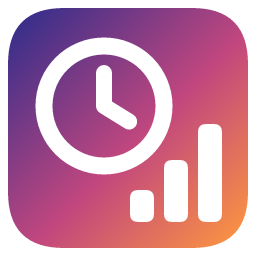
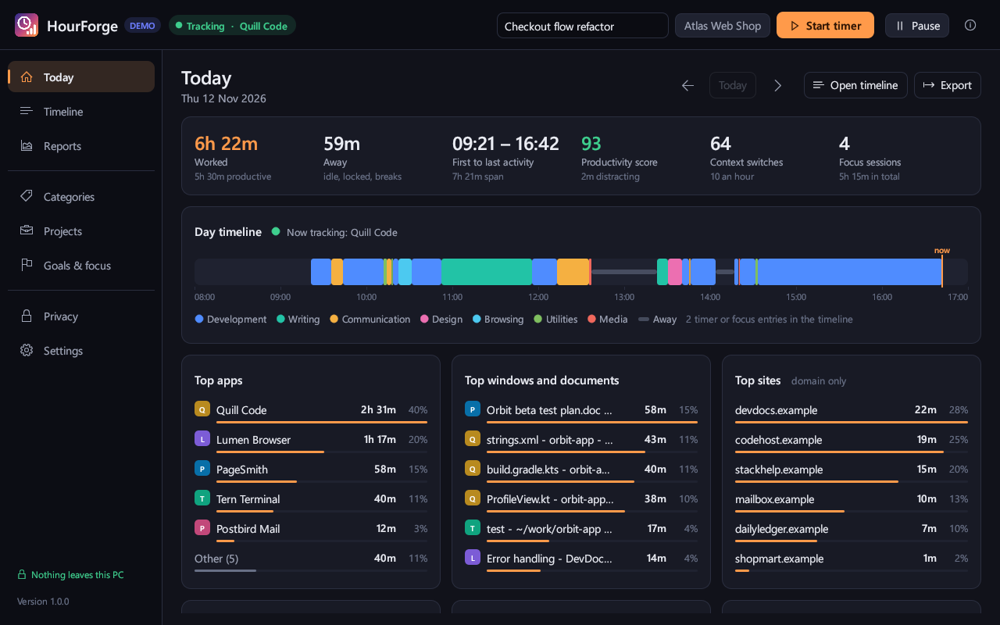
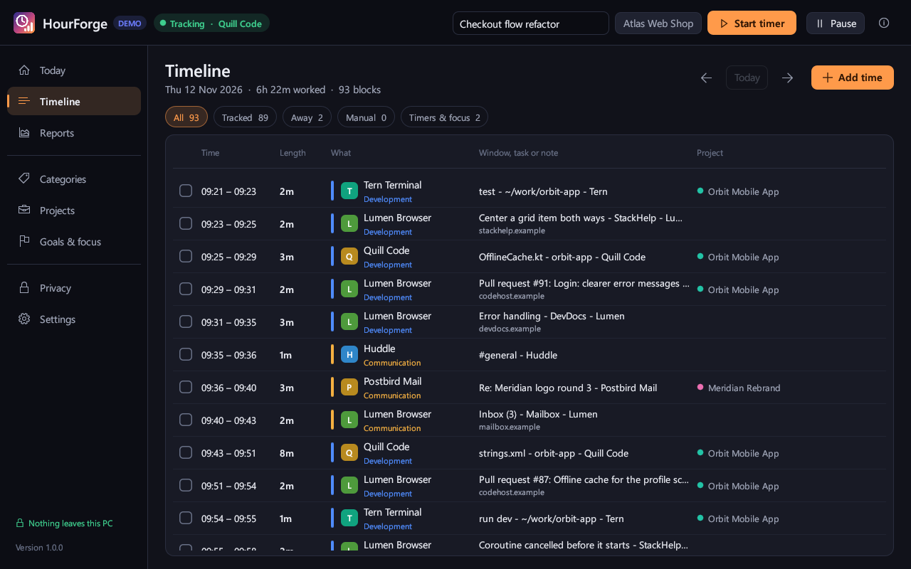
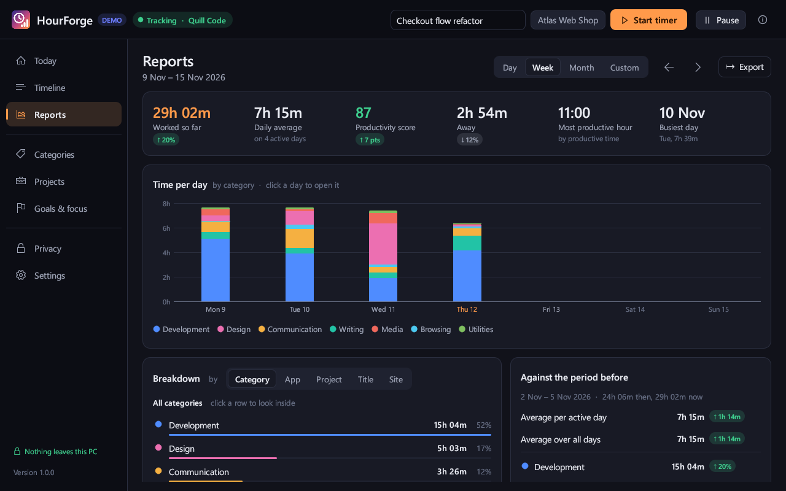
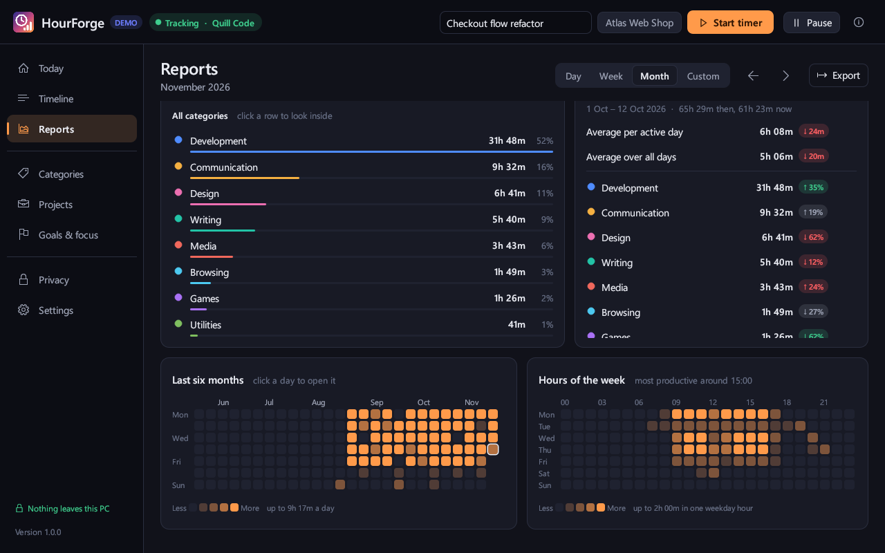
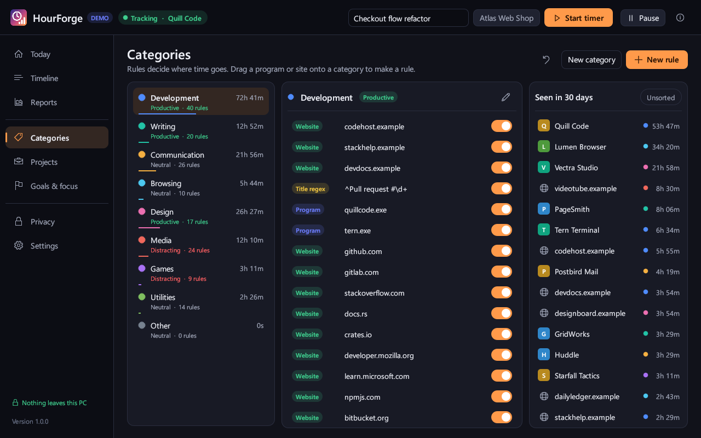
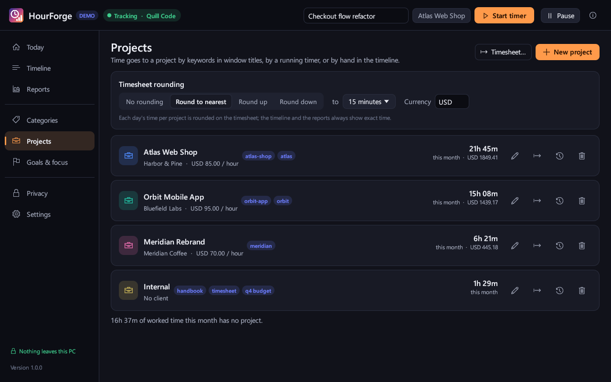
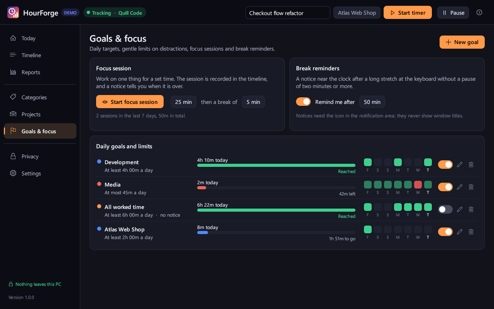
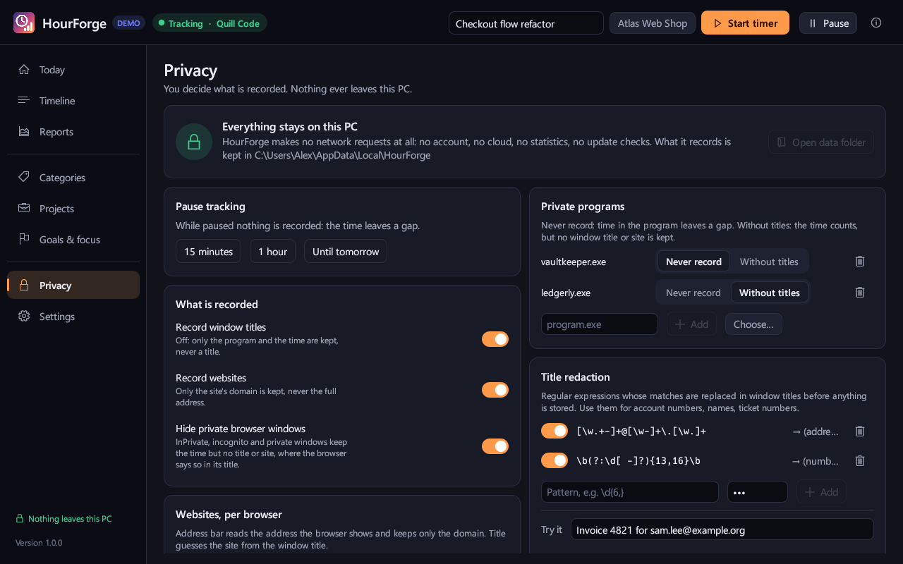
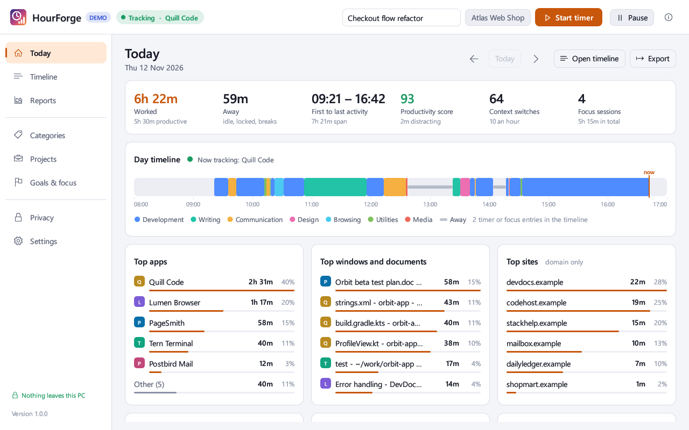

<div align="center">



# HourForge

### See where your time on the computer really goes.

A private, automatic time tracker for Windows, written in **Rust**.
HourForge quietly records which apps, windows and sites you work in and for how long, and turns it into a timeline and reports. Everything stays on your PC.

<p>
  
  
  
  
</p>

<p>
  
  
  
  
  
  
</p>

[**Features**](#-features) ·
[**Screenshots**](#%EF%B8%8F-screenshots) ·
[**Download**](#-download) ·
[**Privacy**](#-privacy) ·
[**Limits**](#-good-to-know) ·
[**Developer**](#-developer)



</div>

---

## ✨ Features

<table>
<tr>
<td width="50%" valign="top">

### ⏱️ Automatic tracking
- Records the app and window you are working in, with no timers to remember
- Website **domain** for browsers
- Notices when you are away, and asks what you were doing when you return (meeting, break, call, or discard)
- Handles lock, sleep and sign-out
- Runs in the tray; about 0.03 % of one processor core in the background

</td>
<td width="50%" valign="top">

### 📅 Today and timeline
- A coloured bar of your day, by category
- Time worked, time away, first and last activity
- Top apps, windows, documents and sites
- Focus sessions and context switches
- Edit the timeline: add offline time, split, merge, delete, add notes

</td>
</tr>
<tr>
<td valign="top">

### 📊 Reports
- Day, week, month or any range
- By app, category, project, window title or site
- Stacked bars, a calendar heatmap, hours of the day, trends against the previous period
- Drill down from category to app to title

</td>
<td valign="top">

### 🏷️ Categories and projects
- Built-in categories with editable rules (program, title, site)
- Drag a program onto a category to make a rule
- Productive, neutral or distracting
- Projects and clients, with timesheets, rounding and hourly rates

</td>
</tr>
<tr>
<td valign="top">

### 🎯 Goals and focus
- Daily targets per category or project
- A gentle alert when a limit on a distracting category is reached
- Break reminders
- A focus timer, and a start/stop timer for explicit tasks with a hotkey

</td>
<td valign="top">

### 📤 Export
- CSV, JSON and HTML reports
- Timesheet export per project
- Command line: `HourForge.exe --export week --format csv`
- Backup and import of your data

</td>
</tr>
</table>

## 🖼️ Screenshots

<table>
<tr>
<td width="50%" align="center"><b>Timeline</b><br></td>
<td width="50%" align="center"><b>Reports</b><br></td>
</tr>
<tr>
<td width="50%" align="center"><b>Calendar heatmap</b><br></td>
<td width="50%" align="center"><b>Categories and rules</b><br></td>
</tr>
<tr>
<td width="50%" align="center"><b>Projects</b><br></td>
<td width="50%" align="center"><b>Goals and focus</b><br></td>
</tr>
<tr>
<td width="50%" align="center"><b>Privacy</b><br></td>
<td width="50%" align="center"><b>Light theme</b><br></td>
</tr>
</table>

<sub>Screenshots use the built-in demo mode (<code>HourForge.exe --demo</code>), with invented apps, sites and projects.</sub>

## 📥 Download

Get it from the [**latest release**](https://github.com/zheerkhalid/hourforge/releases/latest):

| File | What it is |
|---|---|
| `HourForge-Setup.exe` | Per-user installer, with an optional start-with-Windows task |
| `HourForge-x.y.z-portable-x64.zip` | Portable: unzip and run |
| `HourForge.exe` | The bare 6.1 MB EXE |

Closing the window keeps HourForge tracking in the tray. Use the tray menu, or `HourForge.exe --quit`, to stop it.

## 🔒 Privacy

A time tracker sees a lot, so privacy is built in rather than added on:

- **HourForge makes no network requests at all.** Your data is stored only in `%LOCALAPPDATA%\HourForge`.
- **Pause** tracking for 15 minutes, an hour, or until tomorrow.
- **Private apps:** never recorded, or recorded without window titles.
- **Title redaction rules**, and a switch to record no window titles at all.
- **Sites:** only the domain is kept, never the full address or page content.
- **Delete any range** of your history.

## 📌 Good to know

- Private-window detection works only for browsers that mark private windows in the title; some do not.
- A title change inside the same window is picked up within about 2 seconds.
- Titles of windows running as administrator may not be readable.
- The focus timer is a single session, not an automatic work and break cycle.
- Memory use is about 4 MB in the background, more while the window is open.

## 🏗️ Build from source

Requires Rust (stable, MSVC toolchain) on Windows.

```powershell
git clone https://github.com/zheerkhalid/hourforge
cd hourforge
cargo build --release
# -> target\release\HourForge.exe
cargo test
```

| Command | What it does |
|---|---|
| `HourForge.exe --demo` | Invented data; nothing is recorded |
| `HourForge.exe --background` | Start in the tray |
| `HourForge.exe --export week --format csv` | Export without the window |
| `HourForge.exe --selftest` | Feed a synthetic day through the whole pipeline |

The icon is drawn in code at build time. The C runtime is linked statically, so the EXE runs on a clean Windows install.

## 👨‍💻 Developer

<table>
<tr>
<td align="center" width="140">
  <a href="https://zheer.dev">
    
  </a>
</td>
<td>

**Designed and developed by [Zheer Khalid](https://zheer.dev)**

🌐 Website: **[zheer.dev](https://zheer.dev)**  
🐙 GitHub: **[@zheerkhalid](https://github.com/zheerkhalid)**  
🧩 Also by Zheer: **[SnapForge](https://github.com/zheerkhalid/snapforge)**, **[ReelForge](https://github.com/zheerkhalid/reelforge)**, **[UnForge](https://github.com/zheerkhalid/unforge)**, **[KeepForge](https://github.com/zheerkhalid/keepforge)**, **[ShredForge](https://github.com/zheerkhalid/shredforge)**, **[BootForge](https://github.com/zheerkhalid/bootforge)**, **[WireForge](https://github.com/zheerkhalid/wireforge)**, **[TwinForge](https://github.com/zheerkhalid/twinforge)**, **[SpaceForge](https://github.com/zheerkhalid/spaceforge)**, **[RescueForge](https://github.com/zheerkhalid/rescueforge)** and **[FindForge](https://github.com/zheerkhalid/findforge)**

If HourForge is useful to you, a ⭐ on the repo is appreciated.

</td>
</tr>
</table>

## 📄 License

MIT © 2026 [Zheer Khalid](https://zheer.dev). See [`LICENSE`](LICENSE).

<div align="center">
<sub>Built with 🦀 Rust and ❤️ by <a href="https://zheer.dev">zheer.dev</a></sub>
</div>
